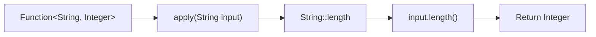

s# Java 8 – Method References (Detailed Notes with Examples)

**Tags:** `Java 8` | `Functional Programming` | `Interview Preparation`

Method References are an important feature of Java 8. They provide a short and readable way to represent a Lambda Expression when that lambda simply calls an existing method.

### Package Structure
```text
p03_method_references/
│
├── StaticMethodReference.java
├── InstanceMethodReference.java
├── ConstructorReference.java
└── ArbitraryObjectMethodReference.java
```

Let's understand each type with runnable examples, explanations, output, and interview questions.

---

## 1. What is a Method Reference?

A **Method Reference** is a shorthand notation of a Lambda Expression that invokes an existing method.

**Lambda Expression:**
```java
Consumer<String> consumer = name -> System.out.println(name);
```

**Method Reference:**
```java
Consumer<String> consumer = System.out::println;
```
*Both perform the same operation.*

### General Syntax
* `ClassName::staticMethodName`
* `objectReference::instanceMethodName`
* `ClassName::instanceMethodName`
* `ClassName::new`

### The Four Common Types of Method References

| Type | Syntax | Example |
| :--- | :--- | :--- |
| **Static Method Reference** | `ClassName::staticMethod` | `Math::abs` |
| **Instance Method Reference** | `object::instanceMethod` | `printer::print` |
| **Constructor Reference** | `ClassName::new` | `ArrayList::new` |
| **Arbitrary Object Method Reference** | `ClassName::instanceMethod` | `String::toUpperCase` |

---

## 2. Type 1: Static Method Reference

### Concept
A Static Method Reference refers to a `static` method of a class. Static methods belong to the class, not to an individual object.

**Syntax:**
```java
ClassName::staticMethodName
```

**Comparison:**
```java
// Using a Lambda Expression
Function<Integer, Integer> function = number -> Math.abs(number);

// Using a Method Reference
Function<Integer, Integer> function = Math::abs;
```
*Both call the static method `Math.abs()`.*

### Code Example: `StaticMethodReference.java`
```java
package p03_method_references;

import java.util.function.Function;
import java.util.function.Consumer;

/**
 * Demonstrates static method references.
 *
 * Static method references point to a static method
 * using ClassName::methodName syntax.
 */
public class StaticMethodReference {

    // Static method to calculate square of a number
    public static int square(int number) {
        return number * number;
    }

    public static void main(String[] args) {

        // Lambda expression calling Math.abs()
        Function<Integer, Integer> absoluteValueLambda =
                number -> Math.abs(number);

        // Method reference calling Math.abs()
        Function<Integer, Integer> absoluteValueReference =
                Math::abs;

        System.out.println(absoluteValueLambda.apply(-10));
        System.out.println(absoluteValueReference.apply(-20));

        // Static method reference to our own method
        Function<Integer, Integer> squareFunction =
                StaticMethodReference::square;

        System.out.println(squareFunction.apply(5));

        // Static method reference with Consumer
        Consumer<String> printMessage =
                StaticMethodReference::print;

        printMessage.accept("Hello Java 8");
    }

    // Static method accepting String
    public static void print(String message) {
        System.out.println(message);
    }
}
```

**Output:**
```text
10
20
25
Hello Java 8
```

### Explanation
* `Math::abs` refers to a static method in the `Math` class.
* `StaticMethodReference::square` refers to our own static method.
* `Function<Integer, Integer>` accepts one `Integer` and returns one `Integer`.
* `Consumer<String>` accepts a `String` and returns nothing (`void`).

### Real-World Example
Calculating the maximum transaction amount from a collection:
```java
List<Integer> amounts = List.of(100, 500, 200, 900);

int maxAmount = amounts.stream()
        .max(Integer::compare)
        .orElse(0);

System.out.println(maxAmount); // Output: 900
```
*`Integer::compare` is a static method reference.*

---

## 3. Type 2: Instance Method Reference

### Concept
An Instance Method Reference refers to an instance method of an **already existing object**. You need an instantiated object before using this method reference.

**Syntax:**
```java
objectReference::instanceMethodName
```

### Code Example: `InstanceMethodReference.java`
```java
package p03_method_references;

import java.util.function.Consumer;
import java.util.function.Supplier;

/**
 * Demonstrates instance method references.
 *
 * An instance method reference uses an existing object
 * to invoke its instance method.
 */
public class InstanceMethodReference {

    // Instance method
    public void display(String message) {
        System.out.println("Message: " + message);
    }

    // Instance method returning a String
    public String getWelcomeMessage() {
        return "Welcome to Java Method References";
    }

    public static void main(String[] args) {

        // Creating an object
        InstanceMethodReference obj =
                new InstanceMethodReference();

        // Lambda expression
        Consumer<String> lambda =
                message -> obj.display(message);

        // Instance method reference
        Consumer<String> methodReference =
                obj::display;

        lambda.accept("Using Lambda");
        methodReference.accept("Using Method Reference");

        // Instance method reference returning a value
        Supplier<String> supplier =
                obj::getWelcomeMessage;

        System.out.println(supplier.get());
    }
}
```

**Output:**
```text
Message: Using Lambda
Message: Using Method Reference
Welcome to Java Method References
```

### Explanation
`obj::display` means:
* `obj` is an existing object.
* `display` is an instance method.
* Java invokes `display()` on that specific object when the functional interface method is called.

| Interface | Input | Output |
| :--- | :--- | :--- |
| `Consumer<String>` | `String` | `void` |
| `Supplier<String>` | None | `String` |

### Real-World Example
```java
class NotificationService {
    public void sendNotification(String message) {
        System.out.println("Notification: " + message);
    }
}

// Usage:
NotificationService service = new NotificationService();

List<String> messages = List.of(
        "Payment successful",
        "Account created",
        "Transaction completed"
);

messages.forEach(service::sendNotification);
```

**Output:**
```text
Notification: Payment successful
Notification: Account created
Notification: Transaction completed
```
*This is heavily used in Spring Boot when calling existing service methods from stream pipelines or callbacks.*

---

## 4. Type 3: Constructor Reference

### Concept
A Constructor Reference is used to refer to a constructor of a class. It is a shorthand for a lambda expression that creates a new object.

**Syntax:**
```java
ClassName::new
```

**Comparison:**
```java
// Method Reference
Supplier<StringBuilder> supplier = StringBuilder::new;

// Equivalent Lambda Expression
Supplier<StringBuilder> supplier = () -> new StringBuilder();
```
*Both create a new `StringBuilder` object when `supplier.get()` is called.*

### Code Example: `ConstructorReference.java`
```java
package p03_method_references;

import java.util.function.Supplier;
import java.util.function.Function;

/**
 * Demonstrates constructor references.
 *
 * Constructor references use ClassName::new
 * to create objects through a functional interface.
 */
public class ConstructorReference {

    // Constructor with no arguments
    public ConstructorReference() {
        System.out.println("Default Constructor Called");
    }

    // Constructor with one String argument
    public ConstructorReference(String name) {
        System.out.println("Name: " + name);
    }

    public static void main(String[] args) {

        // No-argument constructor reference
        Supplier<ConstructorReference> supplier =
                ConstructorReference::new;

        ConstructorReference obj1 = supplier.get();

        // Parameterized constructor reference
        Function<String, ConstructorReference> function =
                ConstructorReference::new;

        ConstructorReference obj2 =
                function.apply("Praveen");
    }
}
```

**Output:**
```text
Default Constructor Called
Name: Praveen
```

### Explanation
* **No-argument constructor (`Supplier<ConstructorReference>`):** `Supplier` accepts no input and returns a `ConstructorReference` object. Calling `get()` invokes the default constructor.
* **Parameterized constructor (`Function<String, ConstructorReference>`):** `Function` accepts a `String` and returns a `ConstructorReference` object. Calling `apply("Praveen")` invokes the matching parameterized constructor.

### Real-World Example: Creating `Employee` Objects
```java
package p03_method_references;

import java.util.List;
import java.util.function.Function;

class Employee {
    private String name;

    public Employee(String name) {
        this.name = name;
    }

    public String getName() {
        return name;
    }
}

public class ConstructorReferenceDemo {
    public static void main(String[] args) {
        // Constructor reference
        Function<String, Employee> employeeFunction = Employee::new;
        Employee employee = employeeFunction.apply("Praveen");
        System.out.println(employee.getName()); // Output: Praveen

        // Stream mapping usage
        List<String> names = List.of("Amit", "Rahul", "Praveen");
        List<Employee> employees = names.stream()
                .map(Employee::new)
                .toList();
    }
}
```
*The `map()` operation transforms each `String` into a new `Employee` instance.*

---

## 5. Type 4: Arbitrary Object Method Reference

### Concept
An Arbitrary Object Method Reference refers to an instance method of a class where the object on which the method is called is supplied as the **input argument** at runtime.

**Syntax:**
```java
ClassName::instanceMethodName
```

> **Note:** While this looks identical in syntax to a static method reference, it behaves differently:
> * **Static method reference:** Refers to a `static` method.
> * **Arbitrary object method reference:** Refers to an `instance` method; the first functional-interface argument becomes the receiver object on which the method is invoked.

**Comparison (`String::toUpperCase`):**
```java
// Lambda Expression
Function<String, String> function = str -> str.toUpperCase();

// Method Reference
Function<String, String> function = String::toUpperCase;
```

### Code Example: `ArbitraryObjectMethodReference.java`
```java
package p03_method_references;

import java.util.function.Function;
import java.util.function.Predicate;
import java.util.List;

/**
 * Demonstrates arbitrary object method references.
 *
 * The object on which the instance method executes
 * is provided as the first argument.
 */
public class ArbitraryObjectMethodReference {

    public static void main(String[] args) {

        // Lambda expression
        Function<String, String> lambda =
                str -> str.toUpperCase();

        // Arbitrary object method reference
        Function<String, String> methodReference =
                String::toUpperCase;

        System.out.println(lambda.apply("java"));
        System.out.println(methodReference.apply("spring boot"));

        // String::length
        Function<String, Integer> lengthFunction =
                String::length;

        System.out.println(lengthFunction.apply("Microservices"));

        // String::isEmpty
        Predicate<String> emptyPredicate =
                String::isEmpty;

        System.out.println(emptyPredicate.test(""));
        System.out.println(emptyPredicate.test("Java"));

        // String::compareTo
        List<String> names = List.of("Amit", "Rahul", "Praveen");

        names.stream()
                .sorted(String::compareTo)
                .forEach(System.out::println);
    }
}
```

**Output:**
```text
JAVA
SPRING BOOT
13
true
false
Amit
Praveen
Rahul
```

### Detailed Explanation
Consider `Function<String, Integer> lengthFunction = String::length;`.
Its functional interface signature is:
```java
@FunctionalInterface
public interface Function<T, R> {
    R apply(T t);
}
```
This method reference is equivalent to `str -> str.length()`. The `String` input acts as the receiver object, and Java invokes the instance method `length()` on it.

---

## 6. Comparison of All Four Method References

| Feature | Static | Instance | Constructor | Arbitrary Object |
| :--- | :--- | :--- | :--- | :--- |
| **Syntax** | `Class::staticMethod` | `obj::method` | `Class::new` | `Class::method` |
| **Method Type** | Static | Instance | Constructor | Instance |
| **Existing Object Required?** | No | Yes | No | No |
| **Object Receiver** | Class | Existing object | New object | Functional input |
| **Example** | `Math::abs` | `obj::display` | `Employee::new` | `String::length` |

### Resolving the Most Common Confusion
Both examples below call `String.length()`, yet they use different functional interfaces:

```java
// 1. Instance Method Reference (Receiver object 'str' is already known)
String str = "java";
Supplier<Integer> supplier = str::length;

// 2. Arbitrary Object Method Reference (Receiver object is provided later as input)
Function<String, Integer> function = String::length;
```

---

## 7. How Java Internally Matches Method References

Java validates a method reference against the abstract method signature of the target functional interface:



The method reference must match both the **parameter types** and **return type**:
* **Compatible:** `Function<String, Integer> function = String::length;` *(Input: `String` receiver, Output: `Integer`)*
* **Incompatible (Compile Error):** `Function<Integer, String> function = String::length;` *(`String.length()` requires a `String` receiver, not an `Integer`)*

---

## 8. Interview Questions and Answers

**Q1. What is a Method Reference in Java?**
> A Method Reference is a shorthand syntax for a lambda expression that invokes an existing method. It uses the `::` operator and improves code readability.

**Q2. How many types of Method References are there?**
> Four commonly discussed types:
> 1. Reference to a static method.
> 2. Reference to an instance method of a particular object.
> 3. Reference to an instance method of an arbitrary object of a particular type.
> 4. Reference to a constructor.

**Q3. Can we use Method References without Functional Interfaces?**
> No, not directly. Method references require a target functional interface type so the compiler can infer which method signature they represent.

**Q4. Is `String::toUpperCase` a static method reference?**
> No. `toUpperCase()` is an instance method on `String`, making `String::toUpperCase` an **arbitrary object instance method reference**.

**Q5. What is the difference between a Lambda Expression and a Method Reference?**
> | Lambda Expression | Method Reference |
> | :--- | :--- |
> | Can contain custom/complex logic | Only refers to an existing method |
> | More flexible | More concise and readable |
> | `x -> x.toUpperCase()` | `String::toUpperCase` |

**Q6. Can a Method Reference invoke a parameterized constructor?**
> Yes, as long as the functional interface signature matches the constructor parameters (e.g., `Function<String, Employee> function = Employee::new;`).

**Q7. Can Method References be used with Streams?**
> Yes, they are commonly used in stream operations like `map()`, `filter()`, `sorted()`, and `forEach()`:
> ```java
> names.stream()
>      .map(String::toUpperCase)
>      .forEach(System.out::println);
> ```

---

## 9. Quick Revision Cheat Sheet

```java
// 1. Static Method Reference
Function<Integer, Integer> f1 = Math::abs;

// 2. Instance Method Reference
Printer printer = new Printer();
Consumer<String> c = printer::print;

// 3. Constructor Reference
Supplier<ArrayList<String>> s = ArrayList::new;

// 4. Arbitrary Object Method Reference
Function<String, Integer> f2 = String::length;
```

---

## 10. Practice Exercises

Test your understanding by converting the following expressions:
1. Convert `x -> Math.abs(x)` into a method reference.
2. Convert `s -> s.toUpperCase()` into a method reference.
3. Convert `() -> new ArrayList<String>()` into a constructor reference.
4. Convert `name -> printer.print(name)` into an instance method reference.
5. Convert `s -> s.length()` into an arbitrary object method reference.
6. Use `Employee::new` with a Stream to convert `List<String>` into `List<Employee>`.

> **Recommended Learning Order:** First understand Lambda Expressions and built-in Functional Interfaces (`Predicate`, `Function`, `Consumer`, `Supplier`). Then practice applying all four types of Method References within Java Stream pipelines.